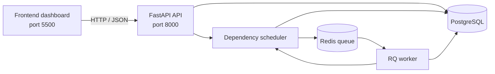

# Distributed Workflow Execution Engine

A small distributed workflow engine for submitting directed acyclic graph (DAG)
workflows, scheduling dependency-aware tasks, executing them with RQ workers,
and monitoring task results and execution logs from a browser dashboard.

## Features

- Workflow creation with DAG validation
- Dependency-aware task scheduling
- Parallel queuing of independent tasks
- Redis-backed RQ task execution
- PostgreSQL persistence for workflows, tasks, and execution logs
- Automatic task retries with a maximum of three attempts
- Workflow and task failure handling
- Execution event history in the API and dashboard
- FastAPI Swagger documentation
- Docker Compose setup for PostgreSQL, Redis, API, and worker services
- Dashboard polling every three seconds for status updates

## Architecture



### Execution flow

1. The client submits a workflow and its tasks to `POST /workflows`.
2. The API validates task IDs, dependencies, and circular references.
3. The scheduler finds tasks whose dependencies are complete.
4. Ready tasks are marked `queued` and added to Redis.
5. An RQ worker marks each task `running`, executes it, and stores its result.
6. Failed tasks are retried until three total attempts have been made.
7. The scheduler queues newly unblocked tasks and completes or fails the workflow.
8. Each important state transition is stored in `execution_logs`.

## Project structure

```text
backend/
  database.py          SQLAlchemy engine and sessions
  logging_utils.py     Execution log helper
  main.py              FastAPI application and API routes
  models.py            Workflow, Task, and ExecutionLog models
  requirements.txt     Python dependencies
  scheduler.py         Dependency scheduling and Redis enqueueing
  schemas.py           Request and response validation
  worker.py            RQ task execution and retries
Frontend/
  index.html           Dashboard markup
  script.js            API calls, polling, and log rendering
  style.css            Dashboard styling
docker-compose.yml     PostgreSQL, Redis, API, and worker services
Dockerfile             API/worker image definition
```

## Quick start with Docker Compose

From the project root:

```bat
docker compose up -d --build
```

Check the service status:

```bat
docker compose ps
curl.exe http://127.0.0.1:8000/health
```

Expected health response:

```json
{"status":"healthy","service":"workflow-api"}
```

Start the dashboard in a separate terminal:

```bat
cd C:\Users\jeswa\distributed-workflow-engine\Frontend
python -m http.server 5500
```

Open:

- Dashboard: http://127.0.0.1:5500
- Swagger UI: http://127.0.0.1:8000/docs

Stop the Compose stack when finished:

```bat
docker compose down
```

The PostgreSQL volume is retained by default. To remove it as well, use
`docker compose down -v`.

## Local development

If PostgreSQL and Redis are already running locally:

```bat
cd C:\Users\jeswa\distributed-workflow-engine
.venv\Scripts\activate.bat
cd backend
uvicorn main:app --reload --host 127.0.0.1 --port 8000
```

In a second terminal, start the worker:

```bat
cd C:\Users\jeswa\distributed-workflow-engine
.venv\Scripts\activate.bat
cd backend
rq worker --worker-class rq.worker.SimpleWorker workflow_tasks
```

In a third terminal, start the frontend:

```bat
cd C:\Users\jeswa\distributed-workflow-engine\Frontend
python -m http.server 5500
```

The backend reads `DATABASE_URL`, `REDIS_HOST`, and `REDIS_PORT` from the
environment. Docker Compose supplies container service names automatically;
local development uses `localhost` defaults.

## API reference

| Method | Endpoint | Purpose |
| --- | --- | --- |
| `GET` | `/health` | Check API health |
| `POST` | `/workflows` | Create and validate a workflow |
| `GET` | `/workflows` | List workflows |
| `GET` | `/workflows/{workflow_id}` | Read workflow and task state |
| `POST` | `/workflows/{workflow_id}/run` | Start a pending workflow |
| `GET` | `/workflows/{workflow_id}/logs` | Read newest execution events first |

## Five-minute demo

### 1. Create a workflow

```bat
curl.exe -X POST http://127.0.0.1:8000/workflows ^
  -H "Content-Type: application/json" ^
  -d "{\"name\":\"Demo workflow\",\"tasks\":[{\"id\":\"collect\",\"name\":\"Collect data\",\"task_type\":\"echo\",\"payload\":{\"message\":\"data collected\"},\"dependencies\":[]},{\"id\":\"process\",\"name\":\"Process data\",\"task_type\":\"echo\",\"payload\":{\"message\":\"data processed\"},\"dependencies\":[\"collect\"]}]}"
```

Copy the `workflow_id` from the response.

### 2. Start execution

Replace `<WORKFLOW_ID>`:

```bat
curl.exe -X POST http://127.0.0.1:8000/workflows/<WORKFLOW_ID>/run
```

### 3. Monitor state and logs

```bat
curl.exe http://127.0.0.1:8000/workflows/<WORKFLOW_ID>
curl.exe http://127.0.0.1:8000/workflows/<WORKFLOW_ID>/logs
```

Refresh or select the workflow in the dashboard to see task status, attempts,
results, and execution logs. The dashboard polls every three seconds.

Expected successful events include:

```text
WORKFLOW_CREATED
WORKFLOW_STARTED
TASK_QUEUED
TASK_STARTED
TASK_COMPLETED
WORKFLOW_COMPLETED
```

## Demonstrating parallel execution

Create two tasks with empty `dependencies` arrays and a third task depending on
both. The first two tasks are eligible at the same time and are queued
together; the third task remains pending until both complete.

```json
{
  "name": "Parallel demo",
  "tasks": [
    {
      "id": "extract-a",
      "name": "Extract A",
      "task_type": "echo",
      "payload": {"message": "A"},
      "dependencies": []
    },
    {
      "id": "extract-b",
      "name": "Extract B",
      "task_type": "echo",
      "payload": {"message": "B"},
      "dependencies": []
    },
    {
      "id": "merge",
      "name": "Merge results",
      "task_type": "echo",
      "payload": {"message": "merged"},
      "dependencies": ["extract-a", "extract-b"]
    }
  ]
}
```

## Demonstrating retries and failure handling

Use an unsupported `task_type` such as `unsupported` to force a task failure.
The worker records the error, logs `TASK_FAILED`, and retries the task until
three total attempts have been made. After the final failure, the task and
workflow become `failed`.

The task response exposes the current `attempts` count and `error` message.
The logs include `TASK_RETRYING` for retryable failures and
`WORKFLOW_FAILED` after retry exhaustion.

## Persistence

SQLAlchemy creates the `workflows`, `tasks`, and `execution_logs` tables during
application startup through `Base.metadata.create_all()`. Existing workflow
data is preserved when the application restarts.


## Troubleshooting

- If the API cannot connect to PostgreSQL or Redis, run `docker compose ps`
  and inspect `docker compose logs api worker`.
- If tasks remain `queued`, confirm the worker is running and listening to
  `workflow_tasks`.
- If a worker was running before a code change, restart it so it loads the
  latest worker code.
- If the browser shows `API Disconnected`, confirm port `8000` is available and
  that the frontend is opened from port `5500`.
