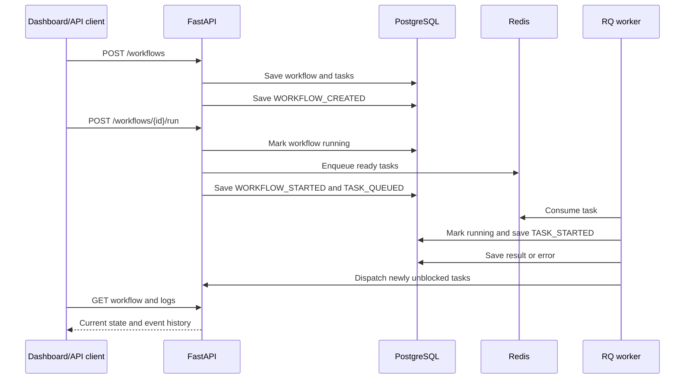

# Distributed Workflow Execution Engine — Project Report

## Abstract

The Distributed Workflow Execution Engine accepts workflows represented as
directed acyclic graphs (DAGs), schedules tasks according to their dependencies,
executes ready tasks through a Redis-backed RQ worker, and exposes progress,
results, failures, retries, and execution history through a FastAPI service and
browser dashboard.

## Problem statement

Many business processes contain dependent steps, such as collecting data,
transforming it, and publishing a result. A workflow engine must ensure that a
task does not run before its prerequisites, while still allowing independent
tasks to run concurrently. It also needs durable state, failure handling, and
operational visibility.

## Objectives

1. Accept and validate dependency-aware workflows.
2. Reject duplicate task IDs, unknown dependencies, self-dependencies, and
   cycles.
3. Queue all currently eligible tasks.
4. Execute tasks outside the API process.
5. Persist task state, results, errors, attempts, and event logs.
6. Retry transient task failures a bounded number of times.
7. Provide an observable browser-based demonstration.
8. Package the backend dependencies with Docker Compose.

## System design

The API is the control plane. It validates requests, persists workflow state,
and asks the scheduler to dispatch ready tasks. Redis is the queue boundary.
RQ workers are the execution plane and update PostgreSQL after each task.
The frontend reads the API and polls for changes every three seconds.

## Core components

| Component | Responsibility |
| --- | --- |
| FastAPI | HTTP API, validation, lifecycle, and CORS |
| SQLAlchemy | Database models and session management |
| PostgreSQL | Durable workflow, task, and log storage |
| Redis | Queue transport |
| RQ | Background worker execution |
| Scheduler | DAG readiness and workflow terminal-state logic |
| Frontend | Creation, execution, monitoring, and log display |
| Docker Compose | Reproducible local service orchestration |

## Data model

- `workflows`: workflow identity, name, status, and creation time.
- `tasks`: task identity, dependency list, payload, state, result, error, and
  attempt count.
- `execution_logs`: append-only event records containing workflow, optional
  task, event name, message, and timestamp.

## Reliability behavior

The worker increments `attempts` before each execution. A task can execute at
most three times. On a retryable failure, its state returns to `pending`, an
error is retained, and the scheduler queues it again. After the third failed
attempt, the task remains `failed` and the scheduler marks the workflow
`failed`. Successful tasks are never retried.

## Demonstrated outcomes

- Linear dependency chains execute in order.
- Independent tasks are queued together.
- Unsupported task types produce stored errors and retry events.
- Completed task results are available from the API and dashboard.
- Execution history is available through `/workflows/{id}/logs`.
- Docker Compose starts PostgreSQL, Redis, API, and worker together.

## Limitations and future work

- The current task type set is intentionally small and centered on `echo`.
- The dashboard uses simple polling rather than WebSockets or server-sent
  events.
- Authentication and multi-user isolation are outside the demonstration scope.
- Production deployments would benefit from migrations, structured logging,
  metrics, backoff, dead-letter queues, and idempotency controls.

## Conclusion

The implementation demonstrates the main control-flow concerns of a
distributed workflow system: DAG validation, dependency scheduling, queue-based
execution, durable state, bounded retries, failure propagation, and
observability. Docker Compose makes the complete backend reproducible for
evaluation and demonstration.
